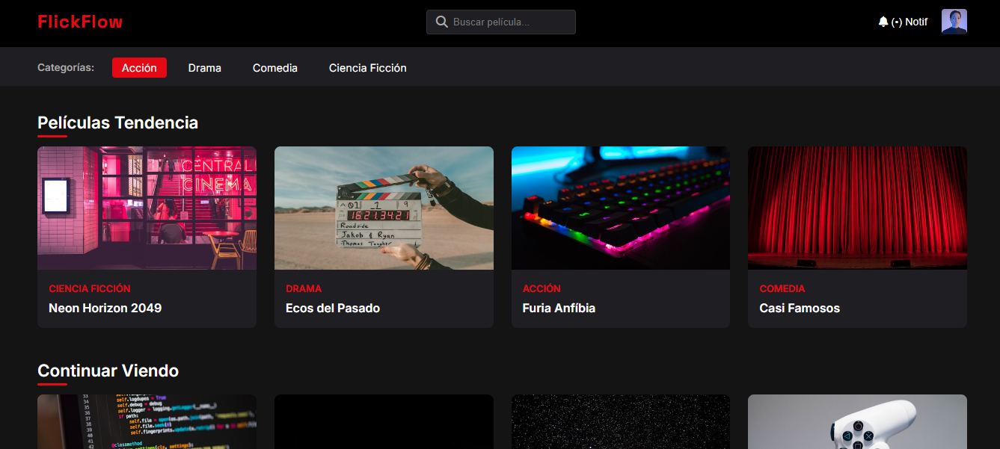

# FlickFlow — Plataforma de streaming

Interfaz de una plataforma de streaming de películas, maquetada con HTML y CSS.

**Demo en vivo:** https://msol1979.github.io/flickflow/

## Sobre el proyecto

Examen Parcial I de **Programación III** — Tecnicatura Superior en Desarrollo de Software, ITSE (Instituto Tecnológico Santiago del Estero), 2026.

## Características

- Barra superior con logo, buscador, notificaciones y perfil de usuario.
- Menú de categorías: Acción, Drama, Comedia y Ciencia Ficción.
- Secciones "Películas Tendencia" y "Continuar Viendo" con tarjetas de películas.
- Grillas de tarjetas que se adaptan al tamaño de la pantalla.
- Diseño oscuro con acentos en rojo, inspirado en las plataformas de streaming actuales.

## Tecnologías

HTML5 semántico · CSS3 (Flexbox y Grid)

## Autora

**María Sol Martínez** — [github.com/msol1979](https://github.com/msol1979)
